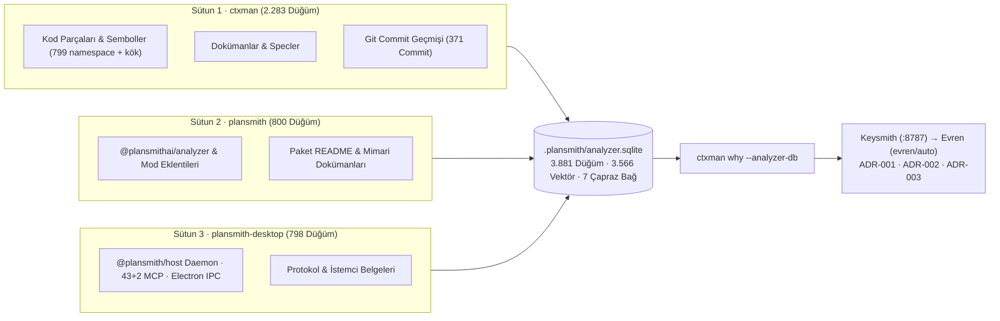

# 3 Sütunlu Ekosistem — Birleşik Çapraz-Depo Bilgi Grafiği ve Uzman Haritası Özeti

Bu belge, `ctxman` (Sütun 1), `plansmith` (`@plansmithai/analyzer`, Sütun 2) ve `plansmith-desktop` (`@plansmith/host` + `smith`, Sütun 3) depolarının tek bir SQLite FTS5 + vektör veritabanında (`.plansmith/analyzer.sqlite`) birleştirilmesiyle elde edilen **çapraz-depo hibrit bilgi grafiğini** ve `ctxman who` (`findExperts`) ile üretilen **uzman haritasını** özetler.

---

## 1. Birleşik Çapraz-Depo Hibrit Bilgi Grafiği (`cross-repo-knowledge-graph.json`)

`@plansmithai/analyzer` CLI'ının çoklu `--repo`, `--chunk`, `--semantic` ve `--namespace` bayrakları kullanılarak üç deponun tamamı tek bir hibrit veritabanına indekslenmiştir.



### 1.1 Genel İstatistikler

| Metrik                                       | Değer                      | Ayrıntı                                                                                  |
| :------------------------------------------- | :------------------------- | :--------------------------------------------------------------------------------------- |
| **Toplam Düğüm (`documentsCount`)**          | **3.881**                  | 3 deponun tüm sembol/kod parçaları, Markdown belgeleri ve Git commit'leri                |
| **Semantik Vektör (`vectorsCount`)**         | **3.566**                  | `--semantic` ile hesaplanan yerel gömme (embedding) vektörleri                           |
| **Çapraz Referans Kenarları (`edgesCount`)** | **7**                      | Dokümanlar, modernizasyon specleri ve commit SHA'ları arasındaki doğrulanmış bağlantılar |
| **Dışa Aktarım Zamanı (`exportedAt`)**       | `2026-11-03T10:00:44.243Z` | `plansmith-analyzer export-graph` çıktısı                                                |

### 1.2 Düğüm Türüne Göre Dağılım (`byKind`)

| Düğüm Türü (`kind`) |      Adet |        Oran | Açıklama                                                                              |
| :------------------ | --------: | ----------: | :------------------------------------------------------------------------------------ |
| **`code`**          | **3.216** |    `%82,87` | `--chunk` ile ayrıştırılmış fonksiyon, sınıf, metot ve modül düzeyinde kod parçaları  |
| **`commit`**        |   **371** |     `%9,56` | Yazar, zaman damgası, mesaj ve değişen dosya listeleriyle indekslenen Git commit'leri |
| **`doc`**           |   **294** |     `%7,57` | `docs/`, `README.md`, `CHANGELOG.md` ve mimari spesifikasyon belgeleri                |
| **Toplam**          | **3.881** | **%100,00** | Tek SQLite FTS5 (`BM25`) + yoğun vektör indeksinde birleşik                           |

### 1.3 Depo / İsim Alanına Göre Dağılım (`byRepo`)

| İsim Alanı / Depo                       | Düğüm Sayısı | Kapsam                                                                                                          |
| :-------------------------------------- | -----------: | :-------------------------------------------------------------------------------------------------------------- |
| **`ctxman` (Kök + Commit + Namespace)** |    **2.283** | `1.484` kök/commit düğümü + `799` `ctxman/` isim alanlı kod ve doküman parçası                                  |
| **`plansmith`**                         |      **800** | `packages/analyzer`, `@plansmithai/mcp`, `apps/extension` (23 VS Code komutu) ve mod paketleri                  |
| **`plansmith-desktop`**                 |      **798** | `host/src` (`43+2` MCP, orkestratör, RPC), `clients/desktop` (`327` `runnerHost`, `258` IPC) ve `plansmith-cli` |
| **Toplam**                              |    **3.881** | 3 sütunlu ekosistemin tam çapraz-depo indeksi                                                                   |

### 1.4 Doğrulanmış Çapraz Referans Kenarları (`edges`)

| Kaynak Düğüm (`from`)                                         | Hedef Düğüm (`to`)   | İlişki Türü                                                         |
| :------------------------------------------------------------ | :------------------- | :------------------------------------------------------------------ |
| `commit:ce98458d068`                                          | `commit:8edc9a45314` | Commit geçmişi / geri dönüş (`revert` / `fixes`) referansı          |
| `commit:ce98458d068`                                          | `commit:d78a835ae70` | Commit zinciri çapraz referansı                                     |
| `doc:docs/specs/modernization/001-eslint-migration.md`        | `commit:23cc1ca6b11` | Modernizasyon spesifikasyonu → uygulama commit'i                    |
| `doc:docs/specs/modernization/002-security-audit.md`          | `commit:e6f4a12c276` | Güvenlik denetimi spesifikasyonu → uygulama commit'i                |
| `doc:ctxman/docs/specs/modernization/001-eslint-migration.md` | `commit:23cc1ca6b11` | İsim alanlı (`ctxman/`) spesifikasyon → uygulama commit'i           |
| `doc:ctxman/docs/specs/modernization/002-security-audit.md`   | `commit:e6f4a12c276` | İsim alanlı (`ctxman/`) güvenlik spesifikasyonu → uygulama commit'i |
| `commit:c8cc3750936`                                          | `commit:558641ffa59` | Sürüm / değişiklik doğrulama referansı                              |

---

## 2. Çapraz-Depo Uzman Haritası (`ctxman who` / `findExperts`)

`ctxman who` komutu; hayatta kalan `git blame -w` satır sahipliğini (`45%`), üstel zaman aşınmalı (`halfLifeDays = 90`) commit geçmişini (`30%`), yakın zamanlı etkinlik yoğunluğunu (`15%`) ve `CODEOWNERS` bildirimlerini (`10%`) birleştirerek 3 sütundaki 6 ana hedef için aşağıdaki uzmanlık skorlarını üretmiştir:

| Sütun / Depo                | Hedef Kapsam (`target`)            | Birincil Uzman                | Uzmanlık Skoru | Blame Satırı / Payı      | Commit / Pay   | Yakınlık (`recencyShare`) |   `CODEOWNERS`    |
| :-------------------------- | :--------------------------------- | :---------------------------- | -------------: | :----------------------- | :------------- | ------------------------: | :---------------: |
| **1 · `ctxman`**            | `lib`                              | Hakki Sagdic (`@hakkisagdic`) |       **0.47** | `0` (`%0` — dizin özeti) | `9` (`%40,9`)  |                   `%68,1` | ✅ `@hakkisagdic` |
| **1 · `ctxman`**            | `lib/api/mcp/server.js`            | Hakki Sagdic (`@hakkisagdic`) |       **0.64** | `302` (`%27,6`)          | `7` (`%58,3`)  |                   `%71,3` | ✅ `@hakkisagdic` |
| **1 · `ctxman`**            | `lib/who/index.js`                 | Hakki Sagdic (`@hakkisagdic`) |       **1.00** | `548` (`%100,0`)         | `1` (`%100,0`) |                  `%100,0` | ✅ `@hakkisagdic` |
| **1 · `ctxman`**            | `"sqlite rag graph"` _(BM25 Konu)_ | Hakki Sagdic (`@hakkisagdic`) |       **0.89** | `490` (`%84,2`)          | `6` (`%50,0`)  |                   `%74,6` | ✅ `@hakkisagdic` |
| **2 · `plansmith`**         | `packages/analyzer`                | Hakki Sagdic (`@hakkisagdic`) |       **1.00** | `642` (`%100,0`)         | `2` (`%100,0`) |                  `%100,0` |         —         |
| **3 · `plansmith-desktop`** | `host/src`                         | Hakki Sagdic (`@hakkisagdic`) |       **1.00** | `3.290` (`%100,0`)       | `2` (`%100,0`) |                  `%100,0` | ✅ `@hakkisagdic` |

---

## 3. Yeniden Üretim ve Doğrulama Komutları

```bash
# 1. Üç depoyu tek SQLite FTS5 + semantik vektör veritabanına indeksle
node ../plansmith/packages/analyzer/dist/cli.js ingest \
  --repo /Users/hakkisagdic/Projects/ctxman \
  --repo /Users/hakkisagdic/Projects/plansmith \
  --repo /Users/hakkisagdic/Projects/plansmith-desktop \
  --db .plansmith/analyzer.sqlite \
  --chunk --semantic --namespace

# 2. Çapraz-depo bilgi grafiğini JSON olarak dışa aktar
node ../plansmith/packages/analyzer/dist/cli.js export-graph \
  --db .plansmith/analyzer.sqlite \
  --out .plansmith/cross-repo-knowledge-graph.json

# 3. Uzman haritasını sorgula (dosya, sembol veya doğal dil konusu)
ctxman who lib/who/index.js --json
ctxman who "sqlite rag graph" --json

# 4. Kurumsal bilgi grafiği kanıtlarıyla modül geçmişini ve ADR girdisini üret
ctxman why lib/who/index.js --analyzer-db .plansmith/analyzer.sqlite
```
