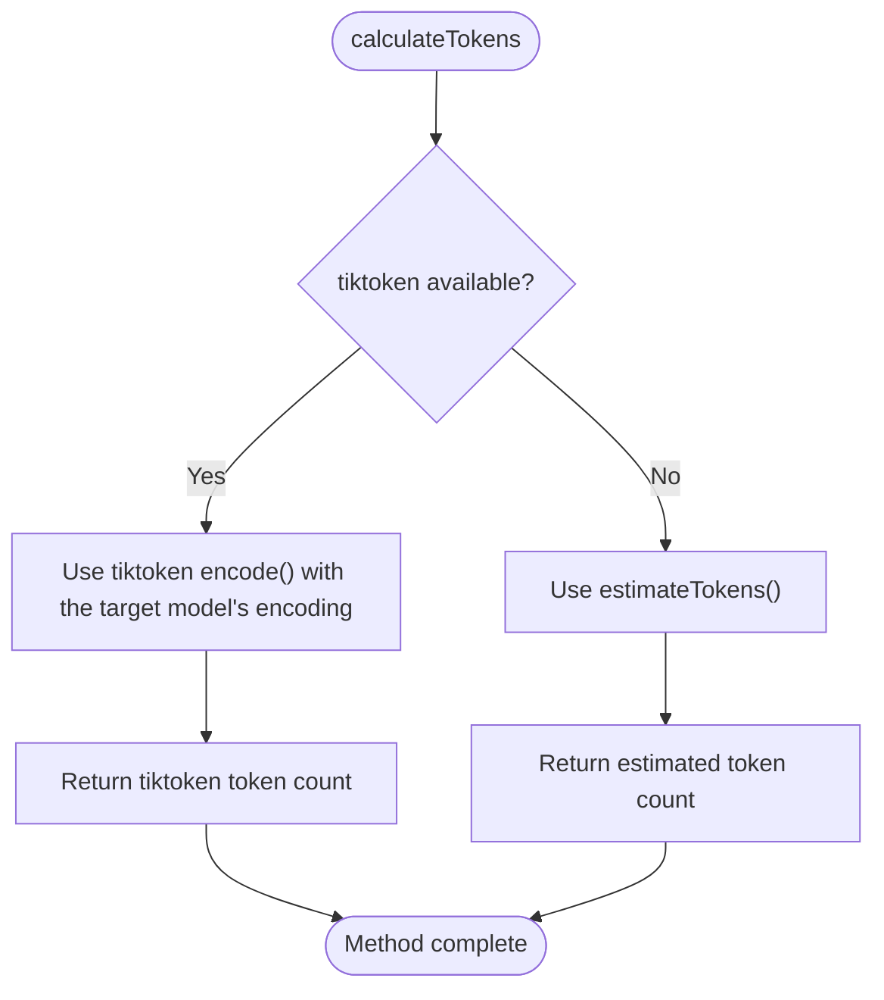
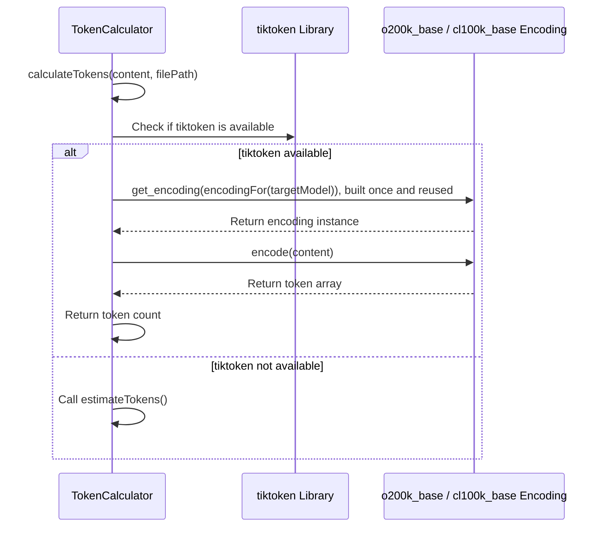
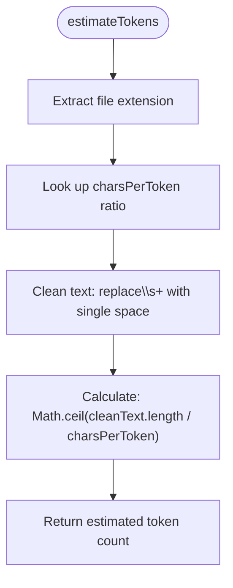
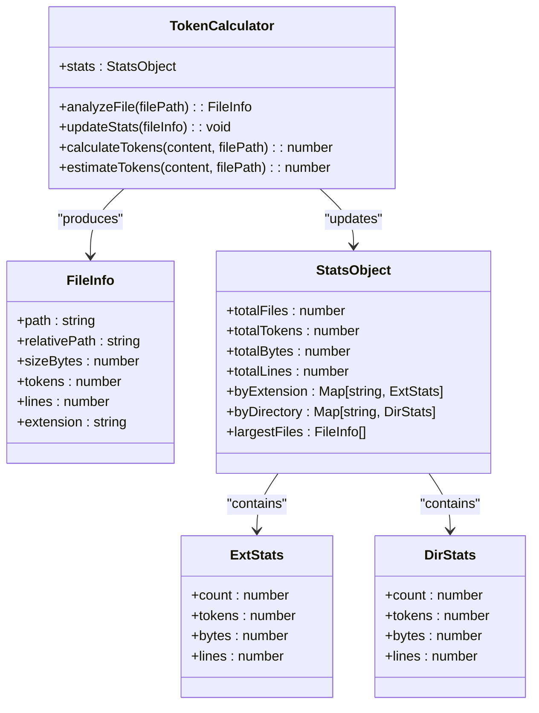

# Token Counting

<cite>
**Referenced Files in This Document**   
- [lib/utils/token-utils.js](file://lib/utils/token-utils.js) - *Updated in recent commit*
- [ctxman.js](file://ctxman.js) - *Modified in recent commit*
- [lib/formatters/gitingest-formatter.js](file://lib/formatters/gitingest-formatter.js) - *Added in recent commit*
- [package.json](file://package.json#L35-L38)
- [README.md](file://README.md#L294-L356)
</cite>

## Update Summary

**Changes Made**

- Updated token counting implementation to use new TokenUtils class
- Added documentation for exact token counting with tiktoken library
- Enhanced estimated token counting section with updated ratios and implementation
- Added integration details with GitIngest formatter
- Updated performance implications section with new findings
- Added troubleshooting guidance for tiktoken installation issues

## Table of Contents

1. [Introduction](#introduction)
2. [Token Calculation Methods](#token-calculation-methods)
3. [Token Counting with tiktoken](#token-counting-with-tiktoken)
4. [Estimated Token Counting Implementation](#estimated-token-counting-implementation)
5. [File Type Specific Examples](#file-type-specific-examples)
6. [Integration with File and Project Statistics](#integration-with-file-and-project-statistics)
7. [LLM Context Generation](#llm-context-generation)
8. [Performance Implications](#performance-implications)
9. [Common Issues and Troubleshooting](#common-issues-and-troubleshooting)
10. [Installation and Configuration](#installation-and-configuration)

## Introduction

The ctxman tool provides sophisticated token counting functionality to support LLM context management and code analysis. The system implements a dual approach to token counting, combining tiktoken counts in the target model's encoding with intelligent estimation methods. This documentation details the implementation, usage, and integration of the token counting system within the ctxman tool.

**Section sources**

- [ctxman.js](file://ctxman.js#L7-L8)
- [README.md](file://README.md#L294-L356)

## Token Calculation Methods

The token counting system in ctxman implements two complementary methods for determining token counts: counting with the tiktoken library (exact for OpenAI models) and estimated counting using character-per-token ratios. The system automatically selects the appropriate method based on library availability and performance requirements.

The primary entry point for token calculation is the `calculateTokens` method in the `TokenCalculator` class, which delegates to the `TokenUtils.calculate` method. This utility class serves as a dispatcher between the tiktoken and estimated counting methods. When tiktoken is available, the system counts with the target model's encoding; otherwise, it falls back to estimation.



**Diagram sources**

- [lib/utils/token-utils.js](file://lib/utils/token-utils.js#L20-L32)

**Section sources**

- [lib/utils/token-utils.js](file://lib/utils/token-utils.js#L20-L32)
- [ctxman.js](file://ctxman.js#L280-L292)

## Token Counting with tiktoken

The ctxman tool counts tokens with the tiktoken library, which is installed with ctxman. The implementation follows a graceful degradation pattern, loading tiktoken at initialization and falling back to estimation if the library cannot be loaded.

The encoding follows the target model (`--target-model`): `o200k_base` for OpenAI models since GPT-4o (GPT-4o, GPT-4.1, GPT-5, GPT-6 and the o-series), and `cl100k_base` for everything else, including GPT-4, GPT-3.5-Turbo and runs without a target model. The counts are exact for OpenAI models up to GPT-5.x. OpenAI has not published GPT-6's encoding, and Claude, Gemini and the other vendors' models use their own tokenizers, so for those models the counts are approximate and the output says so. For exact Claude counts, `ctxman count --model <claude-id> --api` asks Anthropic's count_tokens API (it needs the `@anthropic-ai/sdk` package and `ANTHROPIC_API_KEY`, sends the secret-redacted text, and is free of charge).



**Diagram sources**

- [lib/utils/token-utils.js](file://lib/utils/token-utils.js#L20-L32)
- [package.json](file://package.json#L35-L38)

**Section sources**

- [lib/utils/token-utils.js](file:///Users/hakki.sagdiс/Documents/GitHub/ctxman/lib/utils/token-utils.js#L20-L32)
- [package.json](file://package.json#L35-L38)

## Estimated Token Counting Implementation

When the tiktoken library is unavailable, the ctxman tool falls back to an estimation method that uses extension-specific character-per-token ratios. This approach provides reasonably accurate estimates (~95% accuracy) while maintaining performance and reducing dependencies.

The estimation algorithm follows these steps:

1. Determine the file extension from the filePath parameter
2. Look up the appropriate characters-per-token ratio based on the extension
3. Clean the text by normalizing whitespace
4. Calculate the estimated token count using the character ratio



The implementation includes specific character-per-token ratios for common file types:

- JavaScript/TypeScript: 3.2 characters per token
- JSON: 2.5 characters per token
- Markdown/Text: 4.0 characters per token
- YAML: 3.5 characters per token
- HTML/XML: 2.8 characters per token

**Diagram sources**

- [lib/utils/token-utils.js](file://lib/utils/token-utils.js#L45-L65)

**Section sources**

- [lib/utils/token-utils.js](file://lib/utils/token-utils.js#L45-L65)

## File Type Specific Examples

The token counting system handles different file types appropriately through the extension-specific character-per-token ratios in the estimation method. When tiktoken is available, these ratios are not used.

For JavaScript files (.js, .ts, .jsx, .tsx), the system uses a ratio of 3.2 characters per token, reflecting the typical density of code in these languages. Markdown and plain text files use a more generous 4.0 characters per token, accounting for the higher proportion of spaces and formatting in documentation.

Configuration files like JSON, YAML, and XML have their own specific ratios that reflect their structural characteristics. JSON uses 2.5 characters per token due to its compact syntax with braces, brackets, and quotes, while XML and HTML use 2.8 characters per token to account for tag verbosity.

The system determines if a file should be analyzed as a text file through the `isTextFile` method, which checks both file extensions and common text file names like "readme", "license", and "changelog".

**Section sources**

- [lib/utils/token-utils.js](file://lib/utils/token-utils.js#L45-L65)
- [ctxman.js](file://ctxman.js#L306-L321)

## Integration with File and Project Statistics

Token counts are integrated throughout the file and project statistics system, providing comprehensive analysis of codebase size and complexity. The `analyzeFile` method calls `calculateTokens` for each file and incorporates the results into detailed statistics.

The system maintains multiple levels of statistical aggregation:

- Per-file statistics including token count, size in bytes, and line count
- Extension-level statistics aggregating counts across all files of the same type
- Directory-level statistics showing token distribution by top-level directory
- Project-level summary statistics

These statistics are updated in the `updateStats` method, which processes the file information and accumulates totals for the entire project. The statistics include both raw counts and derived metrics like average tokens per file.



**Diagram sources**

- [ctxman.js](file://ctxman.js#L323-L351)
- [ctxman.js](file://ctxman.js#L455-L480)

**Section sources**

- [ctxman.js](file://ctxman.js#L323-L351)
- [ctxman.js](file://ctxman.js#L455-L480)

## LLM Context Generation

Token counts directly influence LLM context generation through the `generateLLMContext` method, which creates optimized file lists for AI consumption. The context generation process uses token statistics to prioritize files and methods that are most relevant for LLM processing.

When method-level analysis is enabled, the system generates detailed method context including token counts for individual methods. This allows for fine-grained control over which code elements are included in the LLM context.

The context generation supports two formats:

- Compact format: Organized file paths without token counts (~2.3k characters)
- Detailed format: Full method-level information with token counts (~8.6k characters)

The choice of format affects how token counts are presented in the output, with the compact format focusing on file organization and the detailed format providing comprehensive token information for each method.

**Section sources**

- [ctxman.js](file://ctxman.js#L482-L503)

## Performance Implications

The token counting system balances accuracy and performance through its dual-method approach. Counting with tiktoken matches OpenAI's tokenizers but incurs additional overhead from building the encoder (~150 ms, once per encoding) and encoding. Estimated counting is faster and needs no library but provides approximate results.

The performance implications of each method are:

- **tiktoken counting**: exact for OpenAI models up to GPT-5.x, approximate for other vendors; slower
- **Estimated counting**: Lower accuracy (~95%), faster performance, no external dependencies

The startup message shows which one is used: "✅ Exact (using tiktoken) · o200k_base" (or `cl100k_base`) when the library is loaded. When the target model uses its own tokenizer, a second line says that its counts are approximate and, for Claude models, names the `ctxman count --api` command that counts exactly. When tiktoken cannot be loaded, the system falls back to estimation with a "⚠️ Estimated" indicator.

For large codebases, the performance difference becomes more significant, making estimated counting preferable when absolute precision is not required. The estimation method's O(n) complexity for text cleaning and simple division makes it highly efficient even for large files.

**Section sources**

- [ctxman.js](file://ctxman.js#L659-L659)
- [README.md](file://README.md#L294-L356)

## Common Issues and Troubleshooting

Common issues with token counting in the ctxman tool typically relate to inaccurate estimates for non-standard file types or problems with tiktoken installation. The most frequent issues include:

1. **Inaccurate estimates for non-standard file types**: When a file has an uncommon extension not included in the predefined mapping, the system uses a default ratio of 3.5 characters per token. This may lead to inaccurate estimates for specialized file formats.

2. **tiktoken cannot be loaded**: tiktoken is installed with ctxman, but if the installation is broken the system falls back to estimation mode. This can be identified by the "⚠️ Estimated" message during execution; reinstalling ctxman fixes it.

3. **Counts differ from the provider's**: tiktoken matches OpenAI's tokenizers only. Claude, Gemini and other vendors' models count differently (Claude usually counts more tokens for the same code). Use `ctxman count --model <claude-id> --api` for exact Claude counts.

4. **Version compatibility**: The package.json specifies tiktoken version ^1.0.22, and version mismatches could cause loading failures.

To troubleshoot token counting issues, users should first check the startup message to confirm which encoding is used and whether the counts are exact, approximate or estimated.

**Section sources**

- [package.json](file://package.json#L35-L38)
- [README.md](file://README.md#L294-L356)

## Installation and Configuration

tiktoken is a regular dependency in package.json, so installing ctxman installs it; no extra step is needed. Exact Claude counts through `ctxman count --api` additionally need Anthropic's SDK, which ctxman does not install:

```bash
npm install @anthropic-ai/sdk
export ANTHROPIC_API_KEY=sk-ant-...
```

The implementation uses a try-catch block around a dynamic import to load tiktoken, allowing graceful degradation when the library cannot be loaded:

```javascript
let tiktoken = null;
try {
  const tiktokenModule = await import('tiktoken');
  tiktoken = tiktokenModule.default || tiktokenModule;
} catch (_err) {
  // fall back to estimation
}
```

This pattern ensures that the tool remains functional even if tiktoken cannot be loaded. The startup sequence displays the token calculation method being used, helping users verify their installation status.

**Section sources**

- [lib/utils/token-utils.js](file://lib/utils/token-utils.js#L7-L9)
- [package.json](file://package.json#L35-L38)
- [README.md](file://README.md#L294-L356)
