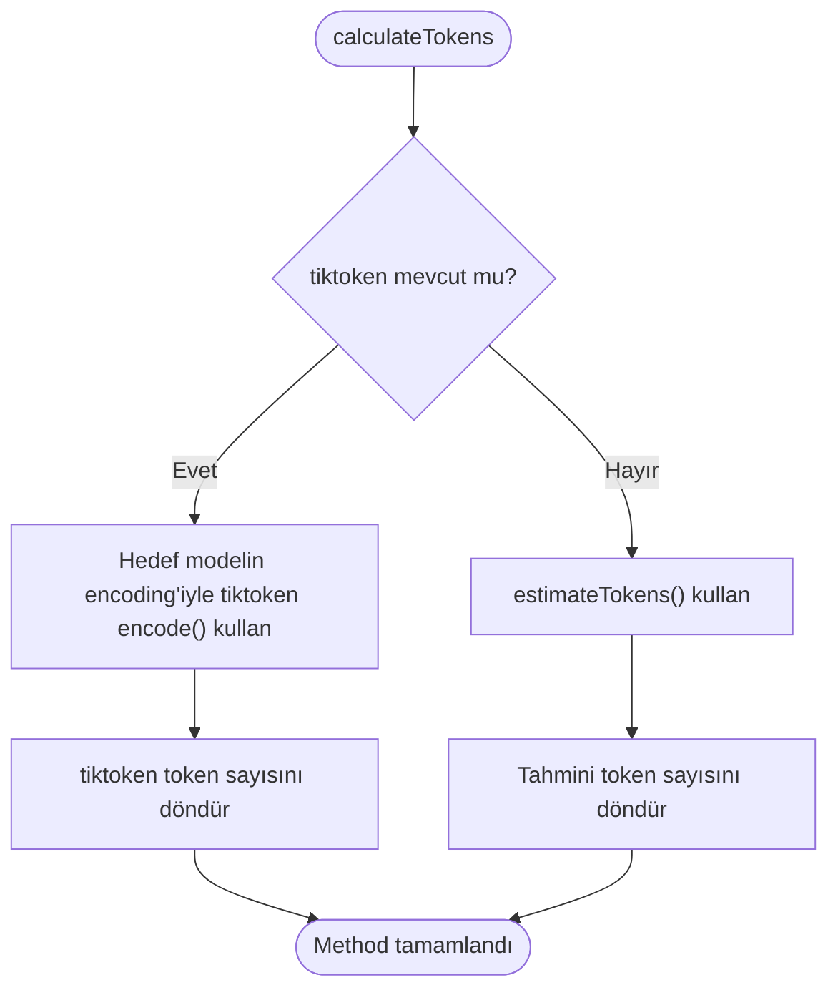
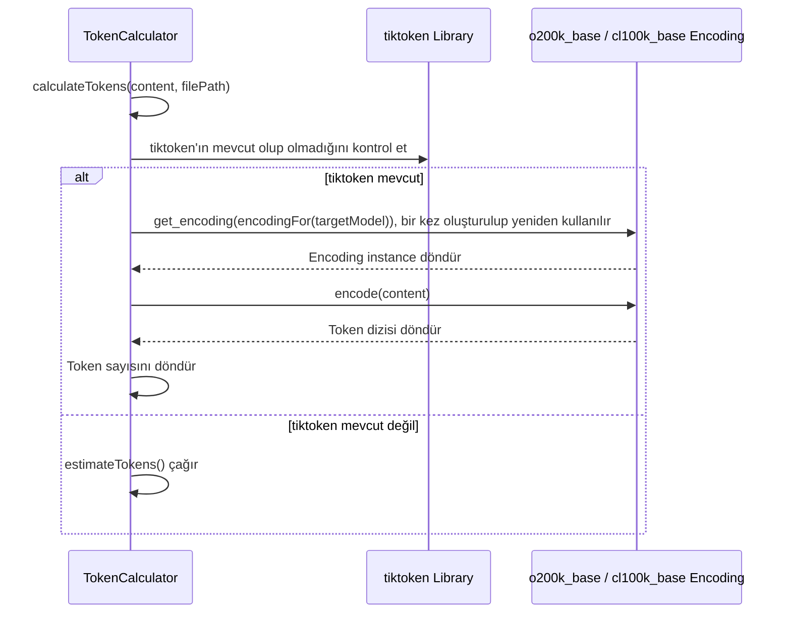
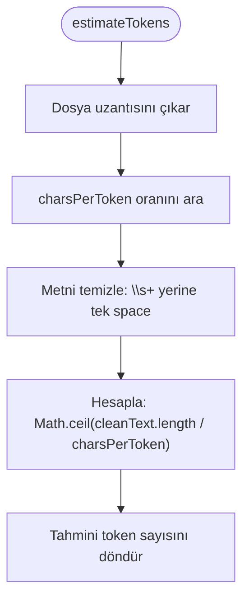
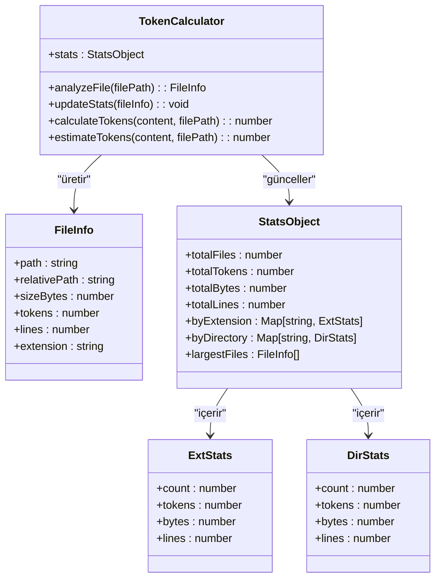

# Token Sayma

<cite>
**Bu Belgedeki Referans Dosyalar**
- [ctxman.js](file://ctxman.js) - *Son commit'te güncellendi*
- [package.json](file://package.json)
- [README.md](file://README.md) - *Son commit'te güncellendi*
- [lib/analyzers/token-calculator.js](file://lib/analyzers/token-calculator.js) - *Son commit'te eklendi*
</cite>

## İçindekiler

1. [Giriş](#giriş)
2. [Token Hesaplama Yöntemleri](#token-hesaplama-yöntemleri)
3. [tiktoken ile Token Sayımı](#tiktoken-ile-token-sayımı)
4. [Tahmini Token Sayımı Implementasyonu](#tahmini-token-sayımı-implementasyonu)
5. [Dosya Türüne Özgü Örnekler](#dosya-türüne-özgü-örnekler)
6. [Dosya ve Proje İstatistikleriyle Entegrasyon](#dosya-ve-proje-i̇statistikleriyle-entegrasyon)
7. [LLM Context Oluşturma](#llm-context-oluşturma)
8. [Performans Etkileri](#performans-etkileri)
9. [Yaygın Sorunlar ve Sorun Giderme](#yaygın-sorunlar-ve-sorun-giderme)
10. [Kurulum ve Yapılandırma](#kurulum-ve-yapılandırma)

## Giriş

ctxman aracı, LLM context yönetimi ve kod analizini desteklemek için sofistike token sayma işlevselliği sağlar. Sistem, hedef modelin encoding'iyle yapılan tiktoken sayımlarını akıllı tahmin yöntemleriyle birleştirerek token sayımına ikili bir yaklaşım uygular. Bu dokümantasyon, ctxman aracı içindeki token sayma sisteminin implementasyonunu, kullanımını ve entegrasyonunu detaylandırır.

**Bölüm kaynakları**

- [ctxman.js](file://ctxman.js#L7-L8)
- [README.md](file://README.md#L294-L356)

## Token Hesaplama Yöntemleri

ctxman'daki token sayma sistemi, token sayılarını belirlemek için iki tamamlayıcı method uygular: tiktoken kütüphanesiyle sayım (OpenAI modelleri için kesin) ve karakter-başına-token oranlarını kullanarak tahmini sayım. Sistem, kütüphane kullanılabilirliğine ve performans gereksinimlerine göre uygun methodu otomatik olarak seçer.

Token hesaplaması için birincil giriş noktası, tiktoken ve tahmini sayım methodları arasında dağıtıcı olarak hizmet eden `TokenCalculator` sınıfındaki `calculateTokens` methodudur. tiktoken mevcut olduğunda, sistem hedef modelin encoding'iyle sayar; aksi takdirde, tahmini hesaplamaya geçer.



**Diyagram kaynakları**

- [ctxman.js](file://ctxman.js#L280-L292)

**Bölüm kaynakları**

- [ctxman.js](file://ctxman.js#L280-L292)

## tiktoken ile Token Sayımı

ctxman aracı, token'ları ctxman ile birlikte kurulan tiktoken kütüphanesiyle sayar. Implementasyon, başlatma sırasında tiktoken'ı yükleyen ve kütüphane yüklenemezse tahmini hesaplamaya geçen zarif bir bozulma modeli izler.

Encoding hedef modele (`--target-model`) göre seçilir: GPT-4o'dan bu yana OpenAI modelleri (GPT-4o, GPT-4.1, GPT-5, GPT-6 ve o serisi) için `o200k_base`; GPT-4, GPT-3.5-Turbo ve hedef model verilmeyen çalıştırmalar dahil diğer her durumda `cl100k_base`. Sayımlar GPT-5.x'e kadarki OpenAI modelleri için kesindir. OpenAI GPT-6'nın encoding'ini yayımlamadığı, Claude, Gemini ve diğer sağlayıcıların modelleri de kendi tokenizer'larını kullandığı için bu modellerde sayımlar yaklaşıktır ve çıktı bunu belirtir. Claude için kesin sayım `ctxman count --model <claude-id> --api` ile Anthropic'in count_tokens API'sinden alınır (`@anthropic-ai/sdk` paketi ve `ANTHROPIC_API_KEY` gerekir; gizli bilgileri maskelenmiş metin gönderilir ve sayım ücretsizdir).



**Diyagram kaynakları**

- [ctxman.js](file://ctxman.js#L280-L292)
- [package.json](file://package.json#L35-L38)

**Bölüm kaynakları**

- [ctxman.js](file://ctxman.js#L280-L292)
- [package.json](file://package.json#L35-L38)

## Tahmini Token Sayımı Implementasyonu

tiktoken kütüphanesi mevcut olmadığında, ctxman aracı uzantıya özgü karakter-başına-token oranları kullanan bir tahmin methoduna geri döner. Bu yaklaşım, performansı korurken ve bağımlılıkları azaltırken makul derecede doğru tahminler (~%95 doğruluk) sağlar.

Tahmin algoritması şu adımları izler:

1. filePath parametresinden dosya uzantısını belirle
2. Uzantıya dayalı uygun karakter-başına-token oranını ara
3. Whitespace'i normalize ederek metni temizle
4. Karakter oranını kullanarak tahmini token sayısını hesapla



Implementasyon, yaygın dosya türleri için spesifik karakter-başına-token oranlarını içerir:

- JavaScript/TypeScript: Token başına 3.2 karakter
- JSON: Token başına 2.5 karakter
- Markdown/Text: Token başına 4.0 karakter
- YAML: Token başına 3.5 karakter
- HTML/XML: Token başına 2.8 karakter

**Diyagram kaynakları**

- [ctxman.js](file://ctxman.js#L294-L304)

**Bölüm kaynakları**

- [ctxman.js](file://ctxman.js#L294-L304)

## Dosya Türüne Özgü Örnekler

Token sayma sistemi, tahmin methodundaki uzantıya özgü karakter-başına-token oranları aracılığıyla farklı dosya türlerini uygun şekilde işler. tiktoken mevcut olduğunda bu oranlar kullanılmaz.

JavaScript dosyaları (.js, .ts, .jsx, .tsx) için sistem, bu dillerdeki kodun tipik yoğunluğunu yansıtan token başına 3.2 karakter oranı kullanır. Markdown ve düz metin dosyaları, dokümantasyondaki daha yüksek boşluk ve formatlama oranını hesaba katarak daha cömert token başına 4.0 karakter kullanır.

JSON, YAML ve XML gibi yapılandırma dosyaları, yapısal özelliklerini yansıtan kendilerine özgü oranlara sahiptir. JSON, süslü parantezler, köşeli parantezler ve tırnak işaretleriyle kompakt sözdizimi nedeniyle token başına 2.5 karakter kullanırken, XML ve HTML tag ayrıntılılığını hesaba katmak için token başına 2.8 karakter kullanır.

Sistem, bir dosyanın metin dosyası olarak analiz edilip edilmeyeceğini, hem dosya uzantılarını hem de "readme", "license" ve "changelog" gibi yaygın metin dosyası adlarını kontrol eden `isTextFile` methodu aracılığıyla belirler.

**Bölüm kaynakları**

- [ctxman.js](file://ctxman.js#L294-L304)
- [ctxman.js](file://ctxman.js#L306-L321)

## Dosya ve Proje İstatistikleriyle Entegrasyon

Token sayıları, codebase boyutu ve karmaşıklığının kapsamlı analizini sağlayan dosya ve proje istatistik sistemi boyunca entegre edilir. `analyzeFile` methodu, her dosya için `calculateTokens`'ı çağırır ve sonuçları ayrıntılı istatistiklere dahil eder.

Sistem, birden fazla istatistiksel toplama seviyesini tutar:

- Token sayısı, byte cinsinden boyut ve satır sayısı dahil dosya başına istatistikler
- Aynı türdeki tüm dosyalarda sayıları toplayan uzantı seviyesi istatistikler
- Üst düzey dizine göre token dağılımını gösteren dizin seviyesi istatistikler
- Proje seviyesi özet istatistikler

Bu istatistikler, dosya bilgilerini işleyen ve tüm proje için toplamları biriktiren `updateStats` methodunda güncellenir. İstatistikler, hem ham sayıları hem de dosya başına ortalama tokenler gibi türetilmiş metrikleri içerir.



**Diyagram kaynakları**

- [ctxman.js](file://ctxman.js#L323-L351)
- [ctxman.js](file://ctxman.js#L455-L480)

**Bölüm kaynakları**

- [ctxman.js](file://ctxman.js#L323-L351)
- [ctxman.js](file://ctxman.js#L455-L480)

## LLM Context Oluşturma

Token sayıları, AI tüketimi için optimize edilmiş dosya listeleri oluşturan `generateLLMContext` methodu aracılığıyla LLM context oluşturmayı doğrudan etkiler. Context oluşturma süreci, LLM işleme için en alakalı dosyaları ve methodları önceliklendirmek için token istatistiklerini kullanır.

Method seviyesi analiz etkinleştirildiğinde, sistem bireysel methodlar için token sayıları dahil olmak üzere ayrıntılı method context'i oluşturur. Bu, hangi kod öğelerinin LLM context'ine dahil edileceği üzerinde ince ayarlı kontrol sağlar.

Context oluşturma iki formatı destekler:

- Kompakt format: Token sayıları olmadan düzenlenmiş dosya yolları (~2.3k karakter)
- Detaylı format: Token sayılarıyla tam method seviyesi bilgisi (~8.6k karakter)

Format seçimi, kompakt format dosya organizasyonuna odaklanırken ve detaylı format her method için kapsamlı token bilgisi sağlarken, token sayılarının çıktıda nasıl sunulduğunu etkiler.

**Bölüm kaynakları**

- [ctxman.js](file://ctxman.js#L482-L503)

## Performans Etkileri

Token sayma sistemi, ikili method yaklaşımı aracılığıyla doğruluk ve performansı dengeler. tiktoken ile sayım OpenAI'ın tokenizer'larıyla eşleşir ancak encoder'ın oluşturulması (encoding başına bir kez, ~150 ms) ve encoding işlemleri ek yük getirir. Tahmini sayım daha hızlıdır ve kütüphane gerektirmez ancak yaklaşık sonuçlar sağlar.

Her methodun performans etkileri şunlardır:

- **tiktoken ile sayım**: GPT-5.x'e kadarki OpenAI modelleri için kesin, diğer sağlayıcılar için yaklaşık; daha yavaş
- **Tahmini sayım**: Daha düşük doğruluk (~%95), daha hızlı performans, harici bağımlılık gerektirmez

Hangi yöntemin kullanıldığını başlangıç mesajı gösterir: kütüphane yüklendiğinde "✅ Exact (using tiktoken) · o200k_base" (veya `cl100k_base`). Hedef model kendi tokenizer'ını kullanıyorsa ikinci bir satır sayımların yaklaşık olduğunu söyler ve Claude modelleri için kesin sayım yapan `ctxman count --api` komutunu gösterir. tiktoken yüklenemezse sistem "⚠️ Estimated" göstergesiyle tahmini hesaplamaya geçer.

Büyük codebase'ler için performans farkı daha önemli hale gelir ve mutlak hassasiyet gerekli olmadığında tahmini sayımı tercih edilir kılar. Tahmin methodunun metin temizleme ve basit bölme için O(n) karmaşıklığı, büyük dosyalar için bile oldukça verimli olmasını sağlar.

**Bölüm kaynakları**

- [ctxman.js](file://ctxman.js#L659-L659)
- [README.md](file://README.md#L294-L356)

## Yaygın Sorunlar ve Sorun Giderme

ctxman aracındaki token sayımıyla ilgili yaygın sorunlar genellikle standart olmayan dosya türleri için yanlış tahminler veya tiktoken kurulum sorunlarıyla ilgilidir. En sık karşılaşılan sorunlar şunlardır:

1. **Standart olmayan dosya türleri için yanlış tahminler**: Bir dosya, önceden tanımlanmış eşlemede yer almayan alışılmadık bir uzantıya sahip olduğunda, sistem varsayılan olarak token başına 3.5 karakter oranı kullanır. Bu, özel dosya formatları için yanlış tahminlere yol açabilir.

2. **tiktoken yüklenemiyor**: tiktoken ctxman ile birlikte kurulur; kurulum bozuksa sistem tahmini moda geri döner. Bu, yürütme sırasında "⚠️ Estimated" mesajıyla anlaşılır; ctxman'i yeniden kurmak sorunu giderir.

3. **Sayımlar sağlayıcınınkinden farklı**: tiktoken yalnızca OpenAI'ın tokenizer'larıyla eşleşir. Claude, Gemini ve diğer sağlayıcıların modelleri farklı sayar (Claude aynı kod için genellikle daha fazla token sayar). Claude için kesin sayım: `ctxman count --model <claude-id> --api`.

4. **Versiyon uyumluluğu**: package.json, tiktoken version ^1.0.22 belirtir ve versiyon uyumsuzlukları yükleme hatalarına neden olabilir.

Token sayma sorunlarını gidermek için kullanıcılar önce başlangıç mesajına bakarak hangi encoding'in kullanıldığını ve sayımların kesin, yaklaşık ya da tahmini olduğunu kontrol etmelidir.

**Bölüm kaynakları**

- [package.json](file://package.json#L35-L38)
- [README.md](file://README.md#L294-L356)

## Kurulum ve Yapılandırma

tiktoken, package.json'da normal bir bağımlılıktır; ctxman kurulduğunda o da kurulur ve ek bir adım gerekmez. `ctxman count --api` ile Claude için kesin sayım ise ctxman'in kurmadığı Anthropic SDK'sını gerektirir:

```bash
npm install @anthropic-ai/sdk
export ANTHROPIC_API_KEY=sk-ant-...
```

Implementasyon, tiktoken'ı dinamik import ile yüklemek için bir try-catch bloğu kullanır ve kütüphane yüklenemediğinde zarif bir bozulmaya izin verir:

```javascript
let tiktoken = null;
try {
  const tiktokenModule = await import('tiktoken');
  tiktoken = tiktokenModule.default || tiktokenModule;
} catch (_err) {
  // tahmine geri dön
}
```

Bu kalıp, tiktoken yüklenemese bile aracın işlevsel kalmasını sağlar. Başlangıç dizisi, kullanılan token hesaplama methodunu görüntüleyerek kullanıcıların kurulum durumlarını doğrulamalarına yardımcı olur.

**Bölüm kaynakları**

- [ctxman.js](file://ctxman.js#L7-L9)
- [package.json](file://package.json#L35-L38)
- [README.md](file://README.md#L294-L356)
