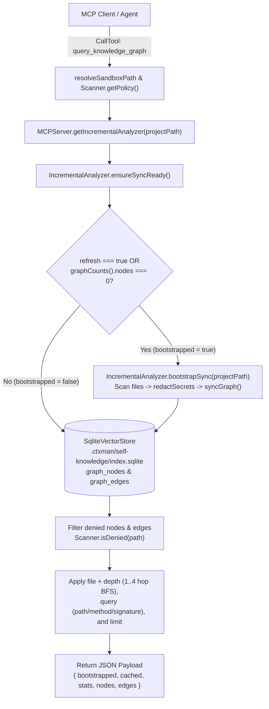

<!--@include: ../docs/adr/knowledge-graph.md-->

---

## `query_knowledge_graph` MCP Tool Architectural Flow

The `query_knowledge_graph` tool in `MCPServer` (`lib/api/mcp/server.js`) provides direct, policy-enforced access to the persistent SQLite knowledge graph (`.ctxman/self-knowledge/index.sqlite`) and the per-project `IncrementalAnalyzer` cache (`lib/watch/IncrementalAnalyzer.js`).

