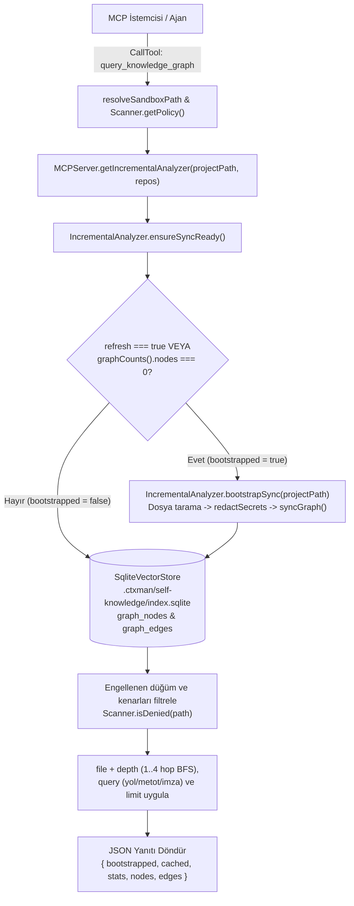

<!--@include: ../../docs/adr/knowledge-graph.md-->

---

## `query_knowledge_graph` MCP Aracı Mimari Akış Diyagramı

`MCPServer` (`lib/api/mcp/server.js`) içindeki `query_knowledge_graph` aracı, kalıcı SQLite bilgi grafiğine (`.ctxman/self-knowledge/index.sqlite`) ve `IncrementalAnalyzer` önbelleğine (`lib/watch/IncrementalAnalyzer.js`) politika korumalı doğrudan erişim sağlar; hem tekli projeleri hem de `<alias>/<path>` altında çoklu depo çalışma alanlarını (`repos` / `ctxman watch --repo <dir>`) destekler.

